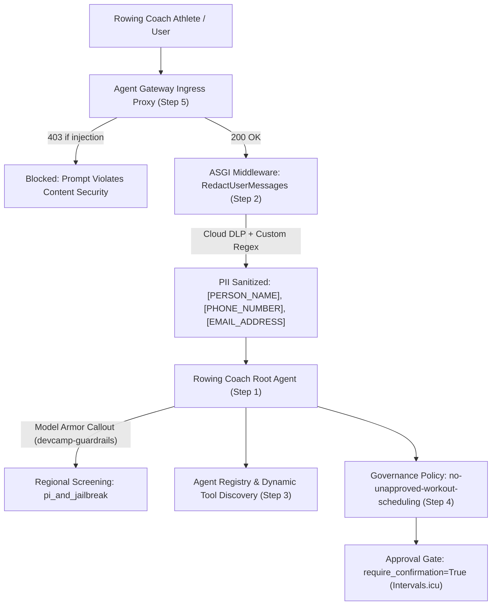

# Part 3: Govern Logic — Implementation Roadmap for Rowing Coach Agent

> **Charter & Execution Standard:** This document is the self-contained, authoritative implementation guide for porting the governance architecture from GDG DevCamp Lab 3 (`Social Spark`) into the `AI-Devcamp-rowing-coach-agent`.
> 
> **Obligatory Rules:**
> 1. **Testing at Each Stage:** You MUST run and pass `uv run pytest` before proceeding to the next step to prevent regressions.
> 2. **Git Commit After Each Step:** Every completed step MUST conclude with a atomic git commit recording the implementation and test verification.
> 3. **Self-Contained:** All commands, code templates, configuration schemas, and verification criteria are contained herein.

---

## Architecture Overview



---

## Step-by-Step Implementation Queue

### Step 1: Model Armor Prompt & Response Screening Guardrails

#### 1.1 Objective
Screen all prompts and responses sent to `rowing-coach-agent` using Google Cloud Model Armor regional templates (`devcamp-guardrails`), intercepting adversarial jailbreaks, prompt injection, and harmful instructions before execution.

#### 1.2 Implementation
1. Add `google-cloud-modelarmor` and `google-cloud-dlp` to dependencies:
   ```bash
   uv add google-cloud-modelarmor google-cloud-dlp
   ```
2. Create `rowing_coach/guardrails.py` implementing Model Armor screening:
   - Regional endpoint binding (`modelarmor.us-central1.rep.googleapis.com` or configured location).
   - Sanitization check for user prompts (`pi_and_jailbreak`, `malicious_uris`, `rai`).
   - Friendly refusal handler: *"This request was flagged by our rowing squad safety policy and cannot be processed."*
3. Connect Model Armor checks into `rowing_coach/agent.py` via ADK `before_turn_callback` or explicit request screening.

#### 1.3 Progress Check & Verification
- Run unit test for Model Armor sanitizer:
  ```bash
  uv run pytest tests/test_guardrails.py -v
  ```
- Verify benign rowing prompts pass, while injection attempts return the exact friendly refusal.

#### 1.4 Obligatory Commit
```bash
git add rowing_coach/guardrails.py pyproject.toml uv.lock tests/test_guardrails.py
git commit -m "feat(govern): implement Model Armor prompt screening and friendly refusal handler"
```

---

### Step 2: Boundary PII Redaction via Pure-ASGI Middleware

#### 2.1 Objective
Implement pure-ASGI middleware to scrub Personal Identifiable Information (PII) — athlete names, email addresses, and domestic phone numbers — before prompts reach the agent or get persisted in Vertex AI durable sessions.

#### 2.2 Implementation
1. Create `pii_middleware.py` at the project root implementing `RedactUserMessages`:
   - Pure-ASGI request body reader and reconstructor.
   - Cloud DLP inspect and de-identify callout with fail-closed semantics.
   - Custom regex detector for domestic telephone numbers without international prefixes.
2. Mount middleware in `main.py`:
   ```python
   from pii_middleware import RedactUserMessages
   if os.environ.get("PII_REDACTION", "off") == "on":
       app.add_middleware(RedactUserMessages)
   ```

#### 2.3 Progress Check & Verification
- Create and run `tests/test_pii_middleware.py`:
  ```bash
  uv run pytest tests/test_pii_middleware.py -v
  ```
- Verify that natural text such as *"Coach, update athlete Daniel Okonkwo at 020 7946 0000"* transforms into *"Coach, update athlete [PERSON_NAME] at [PHONE_NUMBER]"*.

#### 2.4 Obligatory Commit
```bash
git add pii_middleware.py main.py tests/test_pii_middleware.py
git commit -m "feat(govern): add pure-ASGI PII redaction middleware with domestic phone detection"
```

---

### Step 3: Agent Registry & Multi-Tier CLI Tooling

#### 3.1 Objective
Register `rowing-coach-agent` with Google Cloud Agent Registry, assign a cryptographic `RuntimeIdentity`, and enable semantic MCP tool discovery.

#### 3.2 Implementation
1. Create `governance.py` with multi-tier fallback configuration resolution (Flags $\to$ Env Vars $\to$ `.env` $\to$ ADC) upholding POLA.
2. Implement subcommands:
   - `uv run python governance.py registry-agents` (lists registered agents).
   - `uv run python governance.py registry-search "rowing"` or `"intervals"` (searches MCP catalogue).
   - `uv run python governance.py list` (lists active policies).

#### 3.3 Progress Check & Verification
- Run governance CLI commands locally:
  ```bash
  uv run python governance.py registry-agents
  ```
- Run automated tests:
  ```bash
  uv run pytest tests/test_governance_cli.py -v
  ```

#### 3.4 Obligatory Commit
```bash
git add governance.py tests/test_governance_cli.py
git commit -m "feat(govern): implement Agent Registry management CLI with multi-tier config hierarchy"
```

---

### Step 4: Semantic Governance Policy & HITL Approval Safeguard

#### 4.1 Objective
Bind a formal Business Policy to the rowing coach agent identity: *"The coach must never schedule or alter athlete calendar workouts without explicit human approval."* Enforce this constraint at the application layer using ADK's `require_confirmation=True`.

#### 4.2 Implementation
1. Verify that `intervals_server.py` and `schedule_workout` tools enforce `require_confirmation=True`.
2. Register the business policy via `governance.py`:
   ```bash
   uv run python governance.py create-policy \
     "The coach must never schedule or alter athlete calendar workouts without explicit human approval" \
     --name no-unapproved-workout-modifications
   ```
3. Document that while the policy is cryptographically bound in the Google Cloud Console, execution gating is enforced via the ADK confirmation dialog.

#### 4.3 Progress Check & Verification
- Verify tool confirmation in `test_agent.py`:
  ```bash
  uv run pytest tests/test_agent.py -k confirmation -v
  ```

#### 4.4 Obligatory Commit
```bash
git add rowing_coach/agent.py rowing_coach/tools.py tests/test_agent.py
git commit -m "feat(govern): bind semantic governance policy and verify workout scheduling HITL confirmation gate"
```

---

### Step 5: Ingress Defense via Agent Gateway

#### 5.1 Objective
Configure and bind an Agent Gateway edge proxy to intercept incoming `streamQuery` network traffic, rejecting adversarial prompts with `HTTP/2 403 Forbidden` before they reach container memory.

#### 5.2 Implementation
1. Provision the regional Agent Gateway in `us-central1`.
2. Bind the gateway extension and link `rowing-coach-agent` Reasoning Engine ID.
3. Test edge rejection with adversarial payloads.

#### 5.3 Progress Check & Verification
- Execute probe against gateway:
  ```bash
  uv run python probe_gateway.py
  ```
- Confirm `HTTP 403 Forbidden: Model Armor: Prompt violates content security configurations`.

#### 5.4 Obligatory Commit
```bash
git add agents-cli-manifest.yaml deployment_metadata.json
git commit -m "feat(govern): bind Agent Gateway edge proxy and verify 403 ingress rejection"
```

---

## Regression Testing Matrix

| Test Suite | Purpose | Command | Success Criteria |
| :--- | :--- | :--- | :--- |
| **All Unit Tests** | Prevent regression across pacing, erg math, and tools | `uv run pytest tests/test_tools.py tests/test_agent.py` | 14 passed (100%) |
| **Guardrails Suite** | Verify Model Armor detection & refusal phrasing | `uv run pytest tests/test_guardrails.py` | All pass; zero leakage |
| **PII Redaction Suite** | Verify domestic phone & athlete info masking | `uv run pytest tests/test_pii_middleware.py` | Full replacement with infoTypes |
| **Full Build Verification** | Validate total system integrity | `uv run pytest` | All test modules green |
