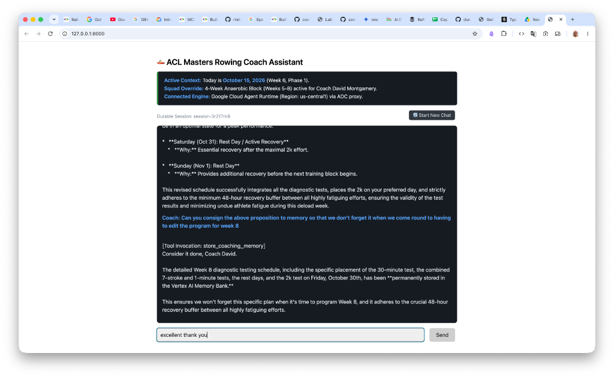
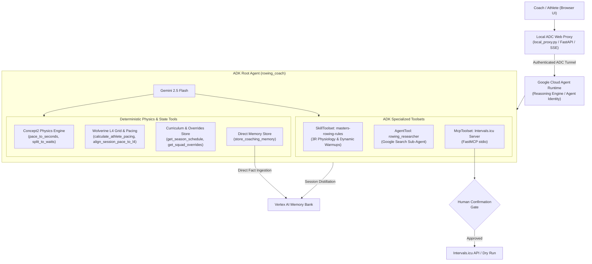

# AI-Devcamp-rowing-coach-agent 🚣‍♂️

[]()
[]()
[]()
[]()
[]()
[]()

> **GDG London AI DevCamp Hackathon Submission (31 October 2026)**  
> An autonomous rowing coach assistant built with the **Google Agent Development Kit (ADK)** and deployed on **Google Cloud Agent Runtime** with **Agent Identity**, **Vertex AI Memory Bank**, **Model Armor regional screening**, **Pure-ASGI PII redaction**, and an **Architectural Blueprint v0.2 multi-region router**. It implements an **evidence-based masters rowing physiology system** and the **Wolverine Plan Level 4 pacing framework** for Masters athletes.

> 🛡️ **CORE BREAKTHROUGH: GDPR ARTICLE 9 SPECIAL CATEGORY HEALTH DATA & CRYPTOGRAPHIC PSEUDONYMIZATION**  
> In competitive rowing, cardiovascular biomarkers, 2k power benchmarks, fatigue scores, and injury records constitute **Special Category Health Data** under European law (GDPR Article 9). Naive redaction makes AI coaching impossible—the assistant cannot identify which athlete's training file or pacing history to consult.  
> **Our Production Solution:** A two-gate cryptographic pseudonym pipeline (`[ATHLETE_ath_5a77195e]`). Raw athlete names, emails, and domestic phone numbers are scrubbed at the pure-ASGI network boundary before prompts ever touch Vertex AI model weights or Google Cloud Logging traces. Algorithmic coaching tools unwrap the cryptographic pseudonym to look up exact benchmark splits and Wolverine L4 tables, while Gate 2 safely rehydrates the coach's view with fail-closed orphan token assertions (`VaultSafetyError`).

📖 **[Live Documentation Site (GitHub Pages)](https://duncmon.github.io/AI-Devcamp-rowing-coach-agent/)** | 🏃 **[4-Pillar Walkthrough & Run-Through](https://duncmon.github.io/AI-Devcamp-rowing-coach-agent/walkthrough.html)** | 🛡️ **[Governance & PII Architecture](https://duncmon.github.io/AI-Devcamp-rowing-coach-agent/governance-and-pii.html)** | 💰 **[Unit Economics & Telemetry](https://duncmon.github.io/AI-Devcamp-rowing-coach-agent/cost-economics.html)** | 📄 **[Submission Design Critique](https://duncmon.github.io/AI-Devcamp-rowing-coach-agent/design-critique.html)**

---

## 🏛️ The 4 Platform Pillars: Walkthrough & Verification

Following the structure established in the DevCamp reference project (`ai-devcamp-labs`), the complete implementation and verification evidence is documented across the four Google Agent Platform pillars:

| Platform Pillar | Scope & Capabilities | Verification & Walkthrough Proof | Core Architectural Invariants |
| :--- | :--- | :--- | :--- |
| **Pillar 1: Build** | Deterministic Physics, Progressive Skills & FastMCP | [**Pillar 1 Walkthrough**](https://duncmon.github.io/AI-Devcamp-rowing-coach-agent/walkthrough.html#pillar-1) | Concept2 equations ($W = 2.80 / (s/500)^3$), Wolverine L4 stroke grid (@16-@28), 13-week Phase 1 curriculum, human confirmation gate (`require_confirmation=True`), resilient plan artifact downloads (`GET /api/plans/{filename:path}`), and Cloud Run executive header `#theme-toggle-btn`. |
| **Pillar 2: Scale** | Agent Runtime, Durable Sessions & Memory Bank | [**Pillar 2 Walkthrough**](https://duncmon.github.io/AI-Devcamp-rowing-coach-agent/walkthrough.html#pillar-2) | Vertex AI Reasoning Engine (`5062846700507365376`), Agent Identity (workload identity), persistent multi-turn sessions, scale-to-zero memory distillation callback. |
| **Pillar 3: Govern** | Dedicated Model Armor & Reversible PII Vault | [**Governance & PII Deep-Dive**](https://duncmon.github.io/AI-Devcamp-rowing-coach-agent/governance-and-pii.html) | Dedicated `rowing-coach-guardrails` in `us-central1`, Cloud DLP domestic phone regexes, Gate 1 & Gate 2 cryptographic token vault (`[ATHLETE_ath_5a77195e]`), 4-checkpoint Model Armor lifecycle (Ingress, Tool Call Gate, Tool Output Shield, Egress SDP), and dual-gate athlete translation bridge (`pseudo_to_engine` and Gate 2 client rehydration with fail-closed `VaultSafetyError`). |
| **Pillar 4: Optimise** | Golden Evals, Fail-Closed Deploy Gate & Telemetry | [**Cost Economics & Eval Gate**](https://duncmon.github.io/AI-Devcamp-rowing-coach-agent/cost-economics.html) | Golden eval suite (`refuse_dangerous_training_load`), mandatory tool rubrics (`rubric_based_tool_use_quality_v1`), exit-code 0 defense, and $0.00/mo cost floor under GCP Free Tier. |

---

## ⚡ Quick Start: Invoking Local or Cloud Execution

Following Twelve-Factor Principle 3 (Deterministic Launch Profiles), the frontend launcher accepts explicit CLI flags:

```bash
# 1. Start Local Backend (:8000)
./run-backend.sh

# 2. Launch Frontend UI bound to Local Backend (:8080)
./run-frontend.sh --local

# 3. OR Launch Frontend UI bound directly to Cloud Vertex AI Reasoning Engine (:8080)
./run-frontend.sh --cloud
```

*Terminal CLI mode is also available for instant streaming:*
```bash
uv run python local_proxy.py cli "What is today's workout progression?"
```

---

## 🎯 What It Does

`AI-Devcamp-rowing-coach-agent` serves as an intelligent co-coach for rowing clubs and masters squads. It bridges the gap between exercise physiology, mechanical ergometer physics, periodized training plans, and operational calendar execution:

1. **Precision Pace & Wattage Calculations:** Applies exact Concept2 mechanical power equations ($W = 2.80 / (s/500)^3$) to calculate athlete-specific training splits across UT3, UT2, UT1, AT, TR, and Wolverine Level 4 stroke rate grids (@16 to @28 SPM).
2. **Dynamic L4 Pacing Alignment:** Automatically snaps aerobic and threshold target intensities (55% 2kW for UT2, 65% for UT1, 80% for AT) to the closest Wolverine L4 stroke rate with explicit split reminders (e.g. `allure L4 @20 (2:31.7)`).
3. **Macrocycle Progression & Deload Enforcement:** Enforces strict periodization rules across a 13-week Phase 1 season curriculum, guarding deload weeks (-30% volume) and distinct competition targets (Manosque Tier 2 rehearsal vs Paris Tier 1 national peak).
4. **Vertex AI Memory Bank Persistence:** Consigns formal coaching directives, athlete injury notes, and squad overrides permanently into long-term memory via the `store_coaching_memory` tool and automatic session distillation.
5. **Dynamic Calendar Progression & Squad Overrides:** Automatically evaluates live calendar progression dynamically and overlays active multi-week training blocks over the base curriculum.
6. **Human-in-the-Loop Wearable & Calendar MCP Integration:** Connects to Intervals.icu via a local FastMCP server (`intervals_server.py`) to query resting heart rate, HRV (rMSSD), and fatigue (ATL/CTL), with confirmation-gated calendar workout scheduling (`require_confirmation=True`).
7. **Enterprise Governance (Lab 3):** Boundary PII redaction via pure-ASGI middleware (`pii_middleware.py`), Google Cloud Model Armor regional prompt screening (`guardrails.py`), and Agent Registry CLI (`governance.py`).
8. **Architectural Blueprint v0.2:** Decoupled sovereign EU boundary (`europe-west1`), multi-region fallback router on HTTP 429 (`backend/llm_router.py`), reversible bracketed PII vault (`backend/pii_vault.py`), and dual-backend zero-cost persistence (`backend/db.py`).
9. **Quality Flywheel & Gated Release (Lab 4):** Golden evaluation suite (`evals/golden.json`), mandatory tool-use rubrics (`evals/eval_config.json`), and fail-closed release gate script (`evals/verify_eval_gate.sh`).
10. **Resilient Artifact Download Route:** Serves generated weekly training sheets and coach notes via `@app.get("/api/plans/{filename:path}")`, unquoting URL entities (spaces `%20`, ampersands `%26`, UTF-8 accents), strictly sanitizing directory traversal paths to base names (`pathlib.Path.name`), searching multi-path container fallbacks (`PROJECT_ROOT / "plans"`, `/code/plans`, `/tmp/plans`), and returning clean HTTP 404s without server crashes.
11. **Dual-Theme Executive Dashboard:** Instantaneous zero-latency light and dark mode toggling via `#theme-toggle-btn` in the Cloud Run UI header, synchronizing DOM classes (`bg-slate-100 text-slate-900` vs `bg-darkbg text-slate-200`) and persisting preference via browser `localStorage` (`rowing-coach-theme`).

---

## 🖥️ Live Interface & Session Interaction

The assistant can be interacted with via the local ADC-secured streaming web proxy (`local_proxy.py`), which communicates directly with the deployed container on Google Cloud Agent Runtime:



---

## 🏗️ Architecture



---

## 🔒 Privacy & Security Posture

- **Zero PII Leakage:** All squad member names and benchmark metrics in this repository are **completely anonymized and synthetic**. 2k reference splits are randomized across the full **1:40.0 to 2:30.0** spectrum with mathematically consistent power outputs.
- **Zero Hardcoded Cloud Secrets:** No GCP project IDs, project numbers, reasoning engine IDs, or API keys are committed in this repository. All credentials are provided through environment variables (`.env`) or standard Google Application Default Credentials (`gcloud auth`).
- **Human Confirmation Gate:** External calendar writes or destructive modifications are strictly guarded by `require_confirmation=True`.
- **4-Checkpoint Model Armor Execution Lifecycle:**
  1. *Checkpoint ① (Ingress Boundary):* Regional prompt template screening (`rowing-coach-guardrails`) intercepting prompt injection and jailbreak payloads (PI/JB v1.2) at the edge, converting security blocks into a friendly squad refusal.
  2. *Checkpoint ② (Tool Call Gate):* Schema validation and interactive human confirmation (`require_confirmation=True`) on mutating calendar tools, preventing unauthorized workout writes.
  3. *Checkpoint ③ (Tool Output Shield):* Indirect prompt injection defense (`tool_output_template_name`) screening untrusted external content retrieved via tools, coupled with architectural sub-agent isolation (`research_agent` via `AgentTool`).
  4. *Checkpoint ④ (Egress Boundary):* Regional response screening (`rowing-coach-guardrails-output`) applying Sensitive Data Protection (SDP) redaction while disabling PI/JB filters to eliminate false-positive blocks, followed by Gate 2 client rehydration with fail-closed orphan token assertions (`VaultSafetyError`).
- **Athlete ID Translation Bridge:** Bi-directional translation resolving the sovereign boundary mismatch between client-side PII-stripped cryptographic tokens (`[ATHLETE_ath_5a77195e]`) and remote Reasoning Engine roster keys (`david_montgamery`) pre-dispatch in `local_proxy.py`, with clean Gate 2 client rehydration on egress.
- **Hackathon Reviewer Gating & IAP Architecture Decision:** The agent is deployed to Google Cloud Run as a live reviewer portal. We evaluated Google Cloud Identity-Aware Proxy (IAP) to gate the endpoint, but intentionally did not retain it because requiring evaluators to authenticate via pre-provisioned IAM accounts creates severe onboarding friction across diverse judge emails during a 3-minute pitch. Instead, the service enforces a single-instance hardware ceiling (`--max-instances 1`, `--min-instances 0`) and requires an access token generated via a cryptographically secure pseudorandom generator (undisclosed to prevent PRNG vulnerability exploitation), injected exclusively via runtime environment variables (`DEMO_PASSCODE`).

---

## 🌐 Live Interactive Reviewer Demo (Google Cloud Run)

Hackathon organizers, judges, and mentors can access the live agent deployment directly:

- **Public Endpoint:** `https://rowing-coach-demo-498585195540.us-central1.run.app`
- **Authentication:** Unauthenticated requests display an evaluator lock screen. Evaluators can unlock the dashboard by entering the passcode provided in the hackathon submission portal, or by opening the direct reviewer link (which automatically sets a secure session cookie).
- **Cost Protection:** The service runs on Cloud Run with `--max-instances 1`, `--min-instances 0`, and 512MiB RAM, ensuring zero idle spend and an absolute cost ceiling against automated web crawler probing.

---

## 🛠️ Tech Stack

Google Agent Development Kit (ADK 2.4.0), Google Cloud Agent Runtime, Agent Identity, Vertex AI Reasoning Engines, Vertex AI Memory Bank, Gemini 2.5 Flash, FastMCP (3.4.4), Concept2 Ergometer Physics Engine, Wolverine Plan Level 4 Model, Evidence-Based Masters Rowing Physiology System, FastAPI, Server-Sent Events (SSE), Python 3.14, Pytest (9.1.1), UV Package Manager, HTTPX.

---

## 🚀 Quickstart

### 1. Prerequisites

- Python 3.12+ (or Python 3.14)
- [uv](https://docs.astral.sh/uv/) installed: `brew install uv`
- [Google Cloud CLI](https://cloud.google.com/sdk) configured with Application Default Credentials: `gcloud auth application-default login`

### 2. Setup Environment

```bash
# Clone the repository
git clone https://github.com/duncmon/AI-Devcamp-rowing-coach-agent.git
cd AI-Devcamp-rowing-coach-agent

# Install dependencies into virtual environment
uv sync

# Configure environment variables
cp .env.example .env
```

### 3. Run Test Suite

```bash
uv run pytest
```

Expected result:
```
tests/test_agent.py ....                                                 [  5%]
tests/test_athlete_vault_resolution.py ....                              [ 10%]
tests/test_demo_auth.py .....                                            [ 16%]
tests/test_docs_site.py .....................                            [ 42%]
tests/test_gate_1_stripping.py ..                                        [ 45%]
tests/test_gate_2_reinsertion.py ..                                      [ 47%]
tests/test_governance_cli.py ....                                        [ 52%]
tests/test_guardrails.py .....                                           [ 58%]
tests/test_persistence_store.py ..                                       [ 61%]
tests/test_pii_middleware.py ..                                          [ 63%]
tests/test_region_fallback.py ..                                         [ 66%]
tests/test_regression_fixes.py ................                          [ 86%]
tests/test_tools.py ...........                                          [100%]
============================== 80 passed in 1.59s ==============================
```

### 4. Run the ADC Web Proxy Interface

```bash
uv run python local_proxy.py serve --port 8000
```

Open [http://localhost:8000](http://localhost:8000) in your browser. The interface connects to your deployed Agent Runtime instance using your local Google Cloud credentials with durable session persistence and real-time streaming.

### 5. Deploy to Google Cloud Agent Runtime

```bash
agents-cli deploy -d agent_runtime --project YOUR_PROJECT_ID --region us-central1 --agent-identity
```

---

## 📂 Repository Structure

```
AI-Devcamp-rowing-coach-agent/
├── data/
│   ├── athletes.json           # Anonymized squad roster & benchmarks
│   └── athletes.md             # Markdown quick-reference roster
├── docs/
│   ├── index.html              # System Architecture & Documentation Gateway
│   ├── walkthrough.html        # 4-Pillar Run-Through & Verification Proof
│   ├── governance-and-pii.html # GDPR Art. 9, Reversible Vault & Model Armor
│   ├── cost-economics.html     # Unit Economics, Telemetry & Evaluation Gate
│   ├── design-critique.html    # Submission Critique & Architectural Post-Mortem
│   ├── ARCHITECTURE_AND_SUBMISSION.md # Raw submission critique source
│   ├── style.css               # Unified responsive design system & dark mode
│   ├── toc.js                  # Dynamic Google Dev Docs sticky TOC
│   ├── lightbox.js             # Full-resolution modal image inspector
│   └── images/                 # Authentic walkthrough screenshots & traces
├── mcp/
│   ├── README.md               # Intervals.icu FastMCP server documentation
│   └── intervals_server.py     # Stdio FastMCP server for athlete readiness & calendar
├── plans/
│   ├── README.md               # Periodization documentation
│   ├── block_1_curriculum.json # 13-week Phase 1 structured session database
│   ├── block_1_manosque_indoor.md # Block 1 meso-cycle road to Manosque
│   ├── season_curriculum.json  # Full season macro-cycle curriculum
│   ├── season_plan_2026_2027.md # Multi-year macro plan
│   └── squad_overrides.json    # Dynamic multi-week squad plan overrides (Anaerobic block)
├── rowing_coach/
│   ├── __init__.py
│   ├── agent.py                # Root ADK Agent, Sub-Agent, Skills & Callbacks
│   └── tools.py                # Concept2 physics, Wolverine L4 pacing, and Memory Bank tools
├── skills/
│   └── masters-rowing-rules/
│       ├── SKILL.md            # Masters rowing rules, 3R system & warmup architecture
│       └── references/
│           └── evidence_based_masters_rowing_training_system_distillation_and_implementation_guide.md # Anonymized reference guide
├── tests/
│   ├── test_agent.py           # Agent structure, toolset and gate verification
│   └── test_tools.py           # Physics, pacing, curriculum, and sheet unit tests
├── .env.example                # Example environment variables template
├── .gcloudignore               # Cloud build ignore rules
├── .gitignore                  # Git ignore rules (secrets, venv, deployment metadata)
├── Dockerfile                  # Agent Runtime container build specification
├── local_proxy.py              # Zero-dependency ADC FastAPI streaming proxy & web UI
├── main.py                     # Agent Runtime entrypoint & streaming handler
├── memory_bank_config.py       # Vertex AI Memory Bank configuration
├── pyproject.toml              # Project dependencies & metadata
└── README.md                   # Project overview & documentation
```

---

## 📜 License

MIT License. Developed for GDG London AI Devcamp.
