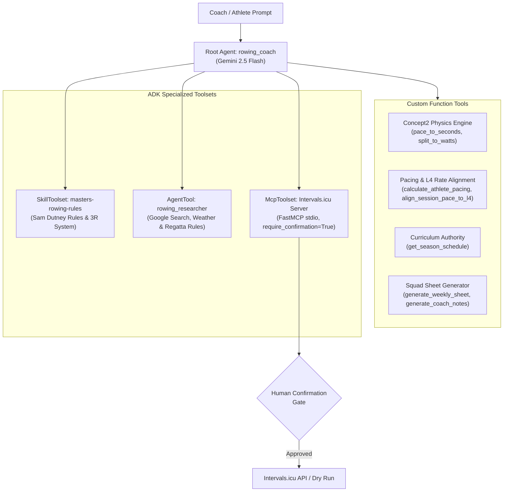

# AI-Devcamp-rowing-coach-agent 🚣‍♂️

[]()
[]()
[]()
[]()

> **GDG London AI Devcamp Submission**  
> An autonomous rowing coach assistant built with the **Google Agent Development Kit (ADK)**, implementing exercise scientist **Sam Dutney's rowing physiology system** and the **Wolverine Plan Level 4 pacing framework** for Masters athletes.

---

## 🎯 What It Does

`AI-Devcamp-rowing-coach-agent` serves as an intelligent co-coach for rowing clubs and masters squads. It bridges the gap between exercise physiology, mechanical ergometer physics, periodized training plans, and operational calendar execution:

1. **Precision Pace & Wattage Calculations:** Applies exact Concept2 mechanical power equations ($W = 2.80 / (s/500)^3$) to calculate athlete-specific training splits across UT3, UT2, UT1, AT, TR, and Wolverine Level 4 stroke rate grids (@16 to @28 SPM).
2. **Dynamic L4 Pacing Alignment:** Automatically snaps aerobic and threshold target intensities (55% 2kW for UT2, 65% for UT1, 80% for AT) to the closest Wolverine L4 stroke rate with explicit split reminders (e.g. `allure L4 @20 (2:31.7)`).
3. **Macrocycle Progression & Deload Enforcement:** Enforces strict periodization rules across a 13-week Phase 1 season curriculum, guarding deload weeks (-30% volume) and distinct competition targets (Manosque Tier 2 rehearsal vs Paris Tier 1 national peak).
4. **Bilingual Squad Documentation Generator:** Automatically outputs French squad fiches matching official club card formats and English technical methodology analysis notes with coaching checkpoints.
5. **Human-in-the-Loop Wearable & Calendar MCP Integration:** Connects to Intervals.icu via a local FastMCP server (`intervals_server.py`) to query resting heart rate, HRV (rMSSD), and fatigue (ATL/CTL), with confirmation-gated calendar workout scheduling (`require_confirmation=True`).
6. **Isolated Web Research Sub-Agent:** Delegates live weather, water conditions (Étang de Berre, Lac des Buissonnets), and official regatta calendars (Ligue Sud PACA, FFAviron) to an isolated sub-agent equipped with Google Search.

---

## 🏗️ Architecture



---

## 🔒 Privacy & PII Compliance

All squad member names and benchmark metrics in this repository are **completely anonymized and synthetic**. 2k reference splits are randomized across the full **1:40.0 to 2:30.0** spectrum with mathematically consistent power outputs to guarantee zero PII leakage.

---

## 🛠️ Tech Stack

Python 3.14, Google ADK (Agent Development Kit 2.4.0), Google GenAI SDK, Vertex AI (Gemini 2.5 Flash & Gemini 2.5 Flash Lite), FastMCP (3.4.4), Intervals.icu REST API, Concept2 Ergometer Physics Engine, Wolverine Plan L4 Model, Sam Dutney Rowing Physiology System, Pytest (9.1.1), UV (Package & Environment Manager), HTTPX (0.28.1), Markdown & JSON Datastore.

---

## 🚀 Quickstart

### 1. Prerequisites

- Python 3.12+ (or Python 3.14)
- [uv](https://docs.astral.sh/uv/) installed: `brew install uv`

### 2. Setup Environment

```bash
# Clone the repository
git clone https://github.com/duncmon/AI-Devcamp-rowing-coach-agent.git
cd AI-Devcamp-rowing-coach-agent

# Install dependencies into virtual environment
uv sync

# Configure environment variables
cp .env.example .env
```

### 3. Run Test Suite

```bash
uv run pytest
```

Expected result:
```
tests/test_agent.py ....                                                 [ 28%]
tests/test_tools.py ..........                                           [100%]
======================== 14 passed in 0.99s ========================
```

---

## 📂 Repository Structure

```
AI-Devcamp-rowing-coach-agent/
├── data/
│   ├── athletes.json           # Anonymized squad roster & benchmarks
│   └── athletes.md             # Markdown quick-reference roster
├── mcp/
│   ├── README.md               # Intervals.icu FastMCP server documentation
│   └── intervals_server.py     # Stdio FastMCP server for athlete readiness & calendar
├── plans/
│   ├── README.md               # Periodization documentation
│   ├── block_1_curriculum.json # 13-week Phase 1 structured session database
│   ├── block_1_manosque_indoor.md # Block 1 meso-cycle road to Manosque
│   ├── season_curriculum.json  # Full season macro-cycle curriculum
│   └── season_plan_2026_2027.md # Multi-year macro plan
├── rowing_coach/
│   ├── __init__.py
│   ├── agent.py                # Root ADK Agent, Sub-Agent, Skills & Callbacks
│   └── tools.py                # Custom physics, pacing, and sheet generation tools
├── skills/
│   └── masters-rowing-rules/
│       ├── SKILL.md            # Sam Dutney rules, 3R system & warmup architecture
│       └── references/
│           └── the_sam_dutney_rowing_training_system_distillation_and_implementation_guide.md # Primary source reference
├── tests/
│   ├── test_agent.py           # Agent structure, toolset and gate verification
│   └── test_tools.py           # Physics, pacing, curriculum, and sheet unit tests
├── .env.example                # Example environment variables template
├── .gitignore                  # Git ignore rules (secrets, venv, pycache)
├── pyproject.toml              # Project dependencies & metadata
└── README.md                   # Project overview & documentation
```

---

## 📜 License

MIT License. Developed for GDG London AI Devcamp.
