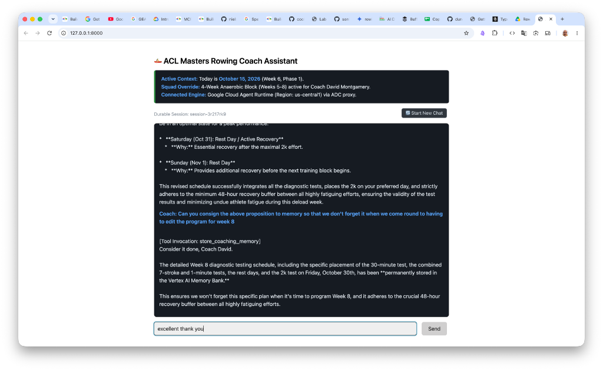
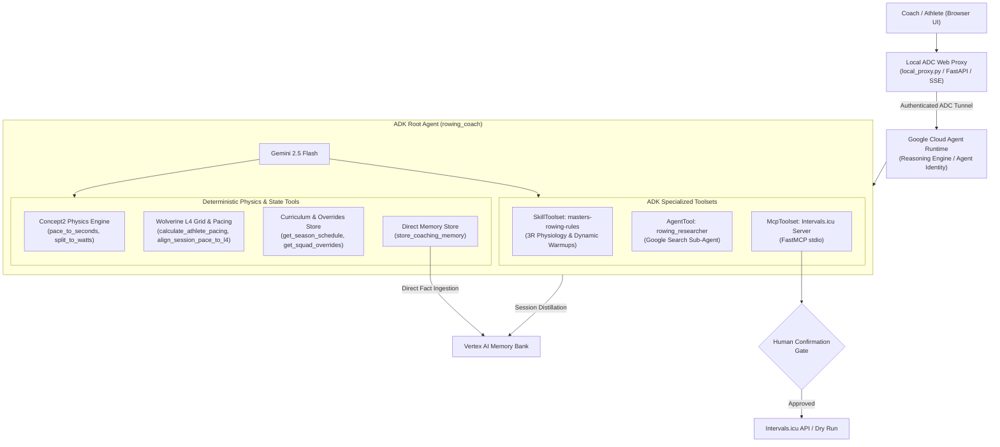

# AI-Devcamp-rowing-coach-agent 🚣‍♂️

[]()
[]()
[]()
[]()
[]()

> **GDG London AI Devcamp Submission**  
> An autonomous rowing coach assistant built with the **Google Agent Development Kit (ADK)** and deployed on **Google Cloud Agent Runtime** with **Agent Identity** and **Vertex AI Memory Bank**. It implements an **evidence-based masters rowing physiology system** and the **Wolverine Plan Level 4 pacing framework** for Masters athletes.

📖 **[Read the Full System Architecture, Design Rationale & Critique](docs/ARCHITECTURE_AND_SUBMISSION.md)**

---

## 🎯 What It Does

`AI-Devcamp-rowing-coach-agent` serves as an intelligent co-coach for rowing clubs and masters squads. It bridges the gap between exercise physiology, mechanical ergometer physics, periodized training plans, and operational calendar execution:

1. **Precision Pace & Wattage Calculations:** Applies exact Concept2 mechanical power equations ($W = 2.80 / (s/500)^3$) to calculate athlete-specific training splits across UT3, UT2, UT1, AT, TR, and Wolverine Level 4 stroke rate grids (@16 to @28 SPM).
2. **Dynamic L4 Pacing Alignment:** Automatically snaps aerobic and threshold target intensities (55% 2kW for UT2, 65% for UT1, 80% for AT) to the closest Wolverine L4 stroke rate with explicit split reminders (e.g. `allure L4 @20 (2:31.7)`).
3. **Macrocycle Progression & Deload Enforcement:** Enforces strict periodization rules across a 13-week Phase 1 season curriculum, guarding deload weeks (-30% volume) and distinct competition targets (Manosque Tier 2 rehearsal vs Paris Tier 1 national peak).
4. **Vertex AI Memory Bank Persistence:** Consigns formal coaching directives, athlete injury notes, and squad overrides permanently into long-term memory via the `store_coaching_memory` tool and automatic session distillation.
5. **Dynamic Calendar Progression & Squad Overrides:** Automatically evaluates current calendar progression (Week 6) and overlays active multi-week training blocks (e.g. 4-Week Anaerobic Block) over the base curriculum.
6. **Human-in-the-Loop Wearable & Calendar MCP Integration:** Connects to Intervals.icu via a local FastMCP server (`intervals_server.py`) to query resting heart rate, HRV (rMSSD), and fatigue (ATL/CTL), with confirmation-gated calendar workout scheduling (`require_confirmation=True`).
7. **Isolated Web Research Sub-Agent:** Delegates live weather, water conditions, and official regatta calendars (Ligue Sud PACA, FFAviron) to an isolated sub-agent equipped with Google Search.

---

## 🖥️ Live Interface & Session Interaction

The assistant can be interacted with via the local ADC-secured streaming web proxy (`local_proxy.py`), which communicates directly with the deployed container on Google Cloud Agent Runtime:



---

## 🏗️ Architecture



---

## 🔒 Privacy & Security Posture

- **Zero PII Leakage:** All squad member names and benchmark metrics in this repository are **completely anonymized and synthetic**. 2k reference splits are randomized across the full **1:40.0 to 2:30.0** spectrum with mathematically consistent power outputs.
- **Zero Hardcoded Cloud Secrets:** No GCP project IDs, project numbers, reasoning engine IDs, or API keys are committed in this repository. All credentials are provided through environment variables (`.env`) or standard Google Application Default Credentials (`gcloud auth`).
- **Human Confirmation Gate:** External calendar writes or destructive modifications are strictly guarded by `require_confirmation=True`.

---

## 🛠️ Tech Stack

Google Agent Development Kit (ADK 2.4.0), Google Cloud Agent Runtime, Agent Identity, Vertex AI Reasoning Engines, Vertex AI Memory Bank, Gemini 2.5 Flash, FastMCP (3.4.4), Concept2 Ergometer Physics Engine, Wolverine Plan Level 4 Model, Evidence-Based Masters Rowing Physiology System, FastAPI, Server-Sent Events (SSE), Python 3.14, Pytest (9.1.1), UV Package Manager, HTTPX.

---

## 🚀 Quickstart

### 1. Prerequisites

- Python 3.12+ (or Python 3.14)
- [uv](https://docs.astral.sh/uv/) installed: `brew install uv`
- [Google Cloud CLI](https://cloud.google.com/sdk) configured with Application Default Credentials: `gcloud auth application-default login`

### 2. Setup Environment

```bash
# Clone the repository
git clone https://github.com/duncmon/AI-Devcamp-rowing-coach-agent.git
cd AI-Devcamp-rowing-coach-agent

# Install dependencies into virtual environment
uv sync

# Configure environment variables
cp .env.example .env
```

### 3. Run Test Suite

```bash
uv run pytest
```

Expected result:
```
tests/test_agent.py ....                                                 [ 28%]
tests/test_tools.py ..........                                           [100%]
======================== 14 passed in 0.99s ========================
```

### 4. Run the ADC Web Proxy Interface

```bash
uv run python local_proxy.py serve --port 8000
```

Open [http://localhost:8000](http://localhost:8000) in your browser. The interface connects to your deployed Agent Runtime instance using your local Google Cloud credentials with durable session persistence and real-time streaming.

### 5. Deploy to Google Cloud Agent Runtime

```bash
agents-cli deploy -d agent_runtime --project YOUR_PROJECT_ID --region us-central1 --agent-identity
```

---

## 📂 Repository Structure

```
AI-Devcamp-rowing-coach-agent/
├── data/
│   ├── athletes.json           # Anonymized squad roster & benchmarks
│   └── athletes.md             # Markdown quick-reference roster
├── docs/
│   ├── ARCHITECTURE_AND_SUBMISSION.md # Comprehensive architecture & critique
│   └── images/
│       └── web_proxy_demo.png  # Web proxy demonstration screenshot
├── mcp/
│   ├── README.md               # Intervals.icu FastMCP server documentation
│   └── intervals_server.py     # Stdio FastMCP server for athlete readiness & calendar
├── plans/
│   ├── README.md               # Periodization documentation
│   ├── block_1_curriculum.json # 13-week Phase 1 structured session database
│   ├── block_1_manosque_indoor.md # Block 1 meso-cycle road to Manosque
│   ├── season_curriculum.json  # Full season macro-cycle curriculum
│   ├── season_plan_2026_2027.md # Multi-year macro plan
│   └── squad_overrides.json    # Dynamic multi-week squad plan overrides (Anaerobic block)
├── rowing_coach/
│   ├── __init__.py
│   ├── agent.py                # Root ADK Agent, Sub-Agent, Skills & Callbacks
│   └── tools.py                # Concept2 physics, Wolverine L4 pacing, and Memory Bank tools
├── skills/
│   └── masters-rowing-rules/
│       ├── SKILL.md            # Masters rowing rules, 3R system & warmup architecture
│       └── references/
│           └── evidence_based_masters_rowing_training_system_distillation_and_implementation_guide.md # Anonymized reference guide
├── tests/
│   ├── test_agent.py           # Agent structure, toolset and gate verification
│   └── test_tools.py           # Physics, pacing, curriculum, and sheet unit tests
├── .env.example                # Example environment variables template
├── .gcloudignore               # Cloud build ignore rules
├── .gitignore                  # Git ignore rules (secrets, venv, deployment metadata)
├── Dockerfile                  # Agent Runtime container build specification
├── local_proxy.py              # Zero-dependency ADC FastAPI streaming proxy & web UI
├── main.py                     # Agent Runtime entrypoint & streaming handler
├── memory_bank_config.py       # Vertex AI Memory Bank configuration
├── pyproject.toml              # Project dependencies & metadata
└── README.md                   # Project overview & documentation
```

---

## 📜 License

MIT License. Developed for GDG London AI Devcamp.
