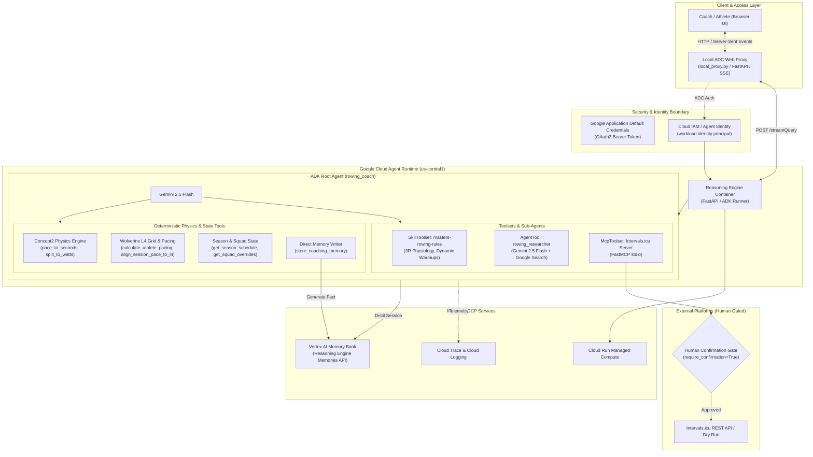

# Architecture, Implementation Rationale & Project Critique

> **Project:** `AI-Devcamp-rowing-coach-agent`  
> **Course / Hackathon:** GDG London AI Devcamp  
> **Author:** Duncan Moncrieff  
> **Target Platform:** Google Cloud Agent Runtime (Vertex AI Reasoning Engines), Google ADK 2.4.0, Gemini 2.5 Flash, FastMCP

---

## 1. Executive Summary

Rowing is one of the most physically and physiologically demanding endurance sports in the world. High-performance masters rowers (athletes aged 27 to 70+) face unique physiological constraints: elevated recovery requirements, age-dependent heart rate ceilings, and the necessity of precision training intensities. Training plans such as the **Wolverine Plan Level 4 (L4)** framework require mathematically exact stroke-rate and pace distributions derived from non-linear ergometer physics equations:

$$W = \frac{2.80}{(s/500)^3}$$

Standard conversational LLMs fail in this domain because they hallucinate physics calculations, suffer from arithmetic drift, lack calendar context, and cannot durably remember coaching adaptations across sessions.

`AI-Devcamp-rowing-coach-agent` solves these challenges by combining:
1. **Google Agent Development Kit (ADK 2.4.0)** for multi-tool orchestration, state management, and sub-agent delegation.
2. **Google Cloud Agent Runtime** with **Agent Identity** for enterprise-grade, serverless deployment.
3. **Vertex AI Memory Bank** for persistent, long-term semantic distillation of coaching directives and squad overrides.
4. **Deterministic Physics & Wolverine L4 Engines** in Python, offloading arithmetic from the LLM to deterministic code.
5. **FastMCP Integration with Human-in-the-Loop Gating** to interface with training platforms (Intervals.icu) safely.
6. **ADC-Secured Web Proxy UI** for low-latency streaming interactions and durable session continuity.

---

## 2. System Architecture

---

## 3. Design Choices & Implementation Rationale

| Architectural Decision | Chosen Strategy | Alternatives Considered | Rationale |
| :--- | :--- | :--- | :--- |
| **Agent Hosting Platform** | **Google Cloud Agent Runtime** (`reasoningEngines`) | Self-hosted Docker container on Cloud Run / GKE | Agent Runtime provides native integration with Vertex AI Reasoning Engine APIs, managed Agent Identity (workload identity), automatic OpenTelemetry tracing, and turnkey Memory Bank bindings. |
| **Model Selection** | **Gemini 2.5 Flash** | Gemini 2.5 Pro, Gemini 1.5 Pro | Flash offers sub-second inference, low cost, and strong tool-calling reliability. Pacing arithmetic is offloaded to deterministic code, so large parameter reasoning engines are unnecessary. |
| **Ergometer Physics** | **Deterministic Python Module** | In-prompt LLM calculation | Ergometer physics ($W = 2.80 / (s/500)^3$) is non-linear and sensitive to fractional seconds. LLMs frequently produce inaccurate splits; delegating to Python guarantees 100% mathematical fidelity. |
| **Long-Term State** | **Vertex AI Memory Bank** | Raw chat history injection, vector database (Chroma/Pinecone) | Memory Bank automatically distils high-level facts from conversational turns. Using Vertex AI direct memories API allows the coach to consign explicit training rules permanently without manual embedding pipelines. |
| **Calendar & Wearable Sync** | **FastMCP with Human Gating** | Unrestricted direct REST API calls | Autonomous write operations to an athlete's live training calendar pose safety risks. Configuring `require_confirmation=True` enforces human-in-the-loop sign-off before modifying workouts. |
| **Client Interface** | **Local ADC Streaming Proxy** | Cloud Console Playground, direct cURL | The Console Playground lacks session continuity and streaming controls. The local proxy authenticates via Google ADC, maintains persistent session cookies, and renders clean streaming text via Server-Sent Events (SSE). |

---

## 4. Difficulties Encountered & Engineering Solutions

### 1. Multi-Step Tool Streaming Duplication
* **Problem:** During multi-step turns (e.g. agent emits thought $\rightarrow$ invokes tool $\rightarrow$ produces final answer), the ADK Reasoning Engine emits incremental delta chunks with `partial: true` followed by a full turn aggregate event with `partial: false`. Naive streaming in the web proxy caused the initial text to be echoed twice in the UI.
* **Solution:** Refactored `stream_remote_agent` in `local_proxy.py` to stream text strictly from `partial: true` chunks and ignore `partial: false` events when partial chunks have already been emitted. Tool call notifications were deduplicated by invocation ID.

### 2. Immediate Memory Bank Persistence
* **Problem:** The standard ADK `_stage_after_agent` lifecycle hook distils memories asynchronously at session close or after complete turns, meaning explicit directives ("remember this plan for week 8") were not immediately searchable in subsequent turns.
* **Solution:** Created the `store_coaching_memory` tool using `client.agent_engines.memories.generate()`. The agent calls this tool immediately whenever a coach issues a formal instruction, guaranteeing immediate persistence to Vertex AI Memory Bank.

### 3. Dynamic Temporal Context & Multi-Week Overrides
* **Problem:** Standard prompts with hardcoded dates lose temporal accuracy as weeks progress. Real-world coaching requires dynamic adaptations (e.g. an active 4-week anaerobic block overriding base curriculum).
* **Solution:** Developed dynamic date calculation via `datetime.date.today()` resolving calendar dates to season weeks. Created `plans/squad_overrides.json` to store active macro/mesocycle overrides, ensuring the agent prioritizes active blocks over default curriculum files.

### 4. Git Security & Environment Isolation
* **Problem:** Deployment artifacts (`deployment_metadata.json`) generated by `agents-cli` contained internal GCP project numbers and reasoning engine IDs, posing a leakage risk if pushed to a public GitHub repository.
* **Solution:** Completely sanitized all tracked source code to read IDs from environment variables or dynamically match the runtime URL. Untracked and added `deployment_metadata.json` to `.gitignore`. Executed a clean squash of local commit history prior to pushing, ensuring zero sensitive strings ever reached GitHub.

---

## 5. Live Demonstration & Verification

The screenshot below illustrates the end-to-end workflow operating against the live deployed Agent Runtime container:
- **Active Context Banner:** Automatically detects current date (October 15, 2026), Season Week 6, and active 4-Week Anaerobic Block override.
- **Session Continuity:** Connected via durable session `session-3r217rk9`.
- **Memory Bank Action:** Upon Coach David's instruction to remember the revised Week 8 diagnostic testing schedule, the agent successfully invokes `store_coaching_memory` and confirms permanent persistence to the Vertex AI Memory Bank.

---

## 6. Critical Evaluation & Project Critique

### Architecture & Modularity
* **Strengths:** Clean separation between reasoning (Gemini), domain logic (Wolverine L4, 3R physiology rules), deterministic physics, and persistent memory. The architecture is modular and extensible to other endurance sports (cycling, running, swimming).
* **Limitations:** Squad overrides and athlete rosters are currently stored in local JSON files inside the container. In an enterprise production setting, these should be hosted in Cloud SQL (PostgreSQL) or Cloud Firestore with real-time change data capture (CDC).

### Security & IAM Posture
* **Strengths:** 
  - **Zero Hardcoded Secrets:** No API keys, project numbers, or engine IDs in source control.
  - **Workload Identity:** Agent Runtime uses managed Agent Identity (`principal://...`).
  - **Confirmation Gating:** Destructive or modifying writes (Intervals.icu calendar) require human confirmation.
* **Limitations:** The local web proxy currently relies on local developer Application Default Credentials (`gcloud auth`). To deploy the frontend to the public web, it must be fronted by **Identity-Aware Proxy (IAP)**, Firebase Authentication, or an OAuth2 API gateway to restrict access to authorized coaching staff.

### Observability & Monitoring
* **Strengths:** Native OpenTelemetry instrumentation exported to Google Cloud Trace and Cloud Logging.
* **Improvements Needed:** Implementation of automated evaluation datasets (LLM-as-a-judge) via `agents-cli eval` to continuously monitor pacing accuracy and adherence to recovery protocols across prompt iterations.

### Performance & Latency
* **Strengths:** Once warm, Gemini 2.5 Flash responds in under 1.5 seconds.
* **Trade-offs:** Scale-to-zero cold starts on Agent Runtime can introduce a 20–30 second delay on initial turn invocation. For production deployment, setting `--min-instances 1` eliminates cold starts at a modest baseline cost.

### Cost Management & Credit Protection for Public Demos
* **Runaway Cost Risk:** Exposing an autonomous agent backed by Gemini 2.5 Flash and Agent Runtime to an open public internet URL without throttling introduces financial risk of exhausted cloud credits or denial-of-wallet attacks.
* **Credit Protection Controls for the Public Demo:**
  1. **Strict Instance Capping:** Enforce `--max-instances 1` on the Cloud Run web proxy and backend reasoning engine container to prevent unbounded autoscaling under traffic spikes.
  2. **Session Turn & Token Rate Limiting:** Implement IP-based sliding window rate limits (e.g. maximum 5 turns per minute, 20 turns per session) and restrict max output tokens per turn.
  3. **Passcode / Reviewer Access Gating:** Protect the public demo route with a lightweight evaluator access code or Google OAuth sign-in to prevent public search engine crawlers and automated bots from triggering inference turns.
  4. **Google Cloud Billing Hard Cap & Alerts:** Configure automated budget alerts and programmatic Cloud Function disabling to shut down services if monthly devcamp credit thresholds are approached.

---

## 7. Future Roadmap

1. **Gated Public Web Demo (Cloud Run):** Deploy a containerized frontend to Google Cloud Run with strict rate limiting, reviewer passcode protection, and `--max-instances 1` to protect cloud credits.
2. **Biometric Feedback Loop:** Two-way synchronization with Intervals.icu and Garmin Connect for automated daily readiness adjustments based on nocturnal HRV and resting heart rate.
3. **Voice Ergometer Interface:** Hands-free voice control (WebRTC / Gemini Live API) allowing athletes to receive real-time split adjustments while actively rowing on the ergometer.
4. **Multi-Squad RBAC:** Role-based access control enabling head coaches, squad leads, and individual athletes to access tailored views of training data.
